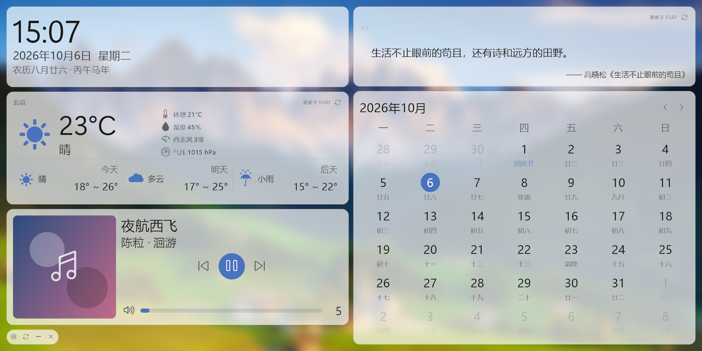

# SubScreen

Windows 副屏信息展示面板。C# / WinForms / .NET Framework 4.7.2，无任何第三方依赖。

打开后自动铺满指定的副屏，只允许最大化（无边框，右上角没有最大化/还原按钮）。
左上时钟、左中天气、左下音乐播控、右上一言、右下日历，左下角有一枚设置/刷新/最小化/关闭的小工具条。

**窗口不在任务栏显示**，入口在托盘图标上：右键出菜单（显示主页面 / 退出），双击图标也能把窗口收回来。
如果托盘图标没出现在通知区域，点任务栏那个 `^` 在溢出面板里找（Windows 11 默认把新图标放进去）。



---

## 一、构建与运行

用 Visual Studio 打开 **`src\SubScreen.slnx`** 直接生成即可（目标框架 .NET Framework 4.7.2，C# 7.3）。

命令行构建：

```powershell
msbuild src\SubScreen.csproj /t:Rebuild /p:Configuration=Release
```

生成结果在 `src\bin\Release\`，**所有可写数据都在 exe 同级的 `config\` 目录下**：

```
src\bin\Release\
  SubScreen.exe
  config\
    settings.ini            全部设置
    background\bg.<ext>     背景图，固定这个名字，换背景会覆盖旧文件
    fonts\                  （可选）放 Font Awesome 5 字体
    cache\crash.log         崩溃日志（有崩溃时才出现）
```

> 注意：因为配置放在 exe 同级，用 Visual Studio 调试时读写的是 `src\bin\Debug\config\`。
> 想保留设置，请把 `config\` 一起复制。

---

## 二、命令行参数（可选，用于排查和自检）

| 参数 | 说明 |
|---|---|
| `--capture <路径>` | 不显示窗口，把界面渲染成一张 PNG 后退出。可配合 `--demo`、`--size` |
| `--demo` | 用样例数据填充天气/一言/播控卡片（离线看界面用） |
| `--size <宽x高>` | 截图模式的画布尺寸，默认 `2160x1080` |
| `--selftest <路径>` | 离线自检：INI 往返、农历/节日、字体、强调色、背景合成、App.config 合法性，把报告写到指定文件 |
| `--trace` | 把启动过程逐步写入 exe 同级的 `startup-trace.log` |

例：

```powershell
SubScreen.exe --capture preview.png --demo --size 2160x1080
SubScreen.exe --selftest selftest.txt
```

---

## 三、设置项（config\settings.ini）

程序里点左下角齿轮即可图形化修改，保存后立即生效。也可以直接改文件（重启生效）。

```ini
[Background]
Kind=Image            ; SolidColor / Image（静态图片）
Color=#14161A         ; 纯色背景色
File=bg.png           ; config\background 下的文件名
Brightness=-15        ; -100..100
Blur=35               ; 0..100，映射到 1..40px 半径
Fit=Fill              ; Fill 填充 / Fit 适应 / Stretch 拉伸 / Tile 平铺 / Center 居中 / Zoom 缩放
Dim=20                ; 0..100 遮罩，图片背景时提升卡片可读性

[Appearance]
Theme=Dark            ; Dark / Light
CardOpacity=72        ; 0..100 卡片背景不透明度
AccentMode=System     ; System 跟随 Windows 强调色 / Custom 自定义
AccentColor=#0078D4   ; 自定义强调色
CornerRadius=10
ColumnRatio=50        ; 左列宽度百分比
TileGap=14            ; 卡片间距
TilePadding=22        ; 卡片内边距
ScreenMargin=22       ; 屏幕四周留白

[Weather]
Host=                 ; 新版 API Host，形如 abcdefg.re.qweatherapi.com
Key=                  ; API Key（明文保存）
City=北京             ; 城市名，或直接填 9 位 LocationID
LocationId=           ; GeoAPI 解析结果缓存，自动写入
RefreshMinutes=30
UseCelsius=1

[Hitokoto]
RefreshMinutes=60
Categories=           ; 留空=不限分类，具体分类查看一言文档

[Media]
RefreshSeconds=1      ; SMTC 播控刷新间隔

[Calendar]
WeekStartsMonday=1
ShowLunar=1
ShowSolarTerm=1
ShowHoliday=1

[General]
ScreenChoice=Auto     ; Auto 自动选面积最大的副屏 / Primary 主屏 / Specific 指定
ScreenDevice=
CoverTaskbar=1        ; 1 = 铺满整屏（覆盖副屏任务栏）
AutoStart=0
ClockShowSeconds=0
ClockUse24Hour=1
```

---

## 四、几个实现上的取舍

**背景**
- 只支持**纯色**和**静态图片**。
- 背景图统一复制并重命名为 `config\background\bg.<原扩展名>`，同时删除该目录下其它 `bg.*`，不会累积垃圾文件。
- 亮度用 GDI+ `ColorMatrix` 在绘制时一次完成；模糊是自写的两趟滑动窗口均值模糊（O(w·h)），只在设置变化时算一次，之后一直是位图拷贝。
- 图片会先按屏幕尺寸降采样再合成，最终只保留一张屏幕大小的合成图。

**系统音量**
- 音乐卡片底部的音量条直接控制 Windows 主音量，走 Core Audio 的 `IAudioEndpointVolume`（`Core\SystemVolume.cs`）。
- 这是**经典 COM**，可以直接用 `[ComImport]` 声明接口，不需要任何第三方库，也不需要 WinRT 那套东西。
- 卡片每秒把系统音量读回来一次，所以用键盘改音量、或别的程序改音量，界面都会跟着变。
- 点喇叭图标切换静音（静音时图标带叉），拖动音量条时自动取消静音。

**布局与渲染**
- 整个界面是**一张自绘表面**，不使用子控件。圆角、半透明、hover、点击全部自己处理，命中测试走"热点矩形"列表。
- 每张卡片各自渲染进一张与自身等大的位图并缓存，只有内容变化才重绘。所以时钟每秒跳秒、进度条每秒推进都只重绘那一张卡片，不会引起全屏重绘。
- 所有尺寸以 1920×1080@96DPI 为基准按比例缩放，换分辨率/DPI 不用重调。

**图标**
- 界面图标用 Windows 11 自带的 `Segoe Fluent Icons`；天气符号用 `Segoe UI Symbol` 的标准 Unicode 天气符号（☀☁⛅☔⛈⚡❄）。两者都是单色字体，颜色跟随主题。
- 这些字体只用私有使用区码位，所以本项目里用到的每个图标码位都是在 Windows 11 (build 26300) 上**实际渲染确认过**的，不是从文档抄的。
- **风速没有图标可用**：把 `Segoe Fluent Icons` 里 1572 个已映射码位逐块渲染看了一遍，没有任何字形能认定为"风"。风速改用半圆速度表（风速本身就是速度指标）。
- 如果往 `config\fonts\` 里放 Font Awesome 5 字体，程序会优先加载它（`Core\IconFont.cs` 里预留了接入点）。

**程序图标（`app.ico`，一个坑）**
- 同时做两件事：`<ApplicationIcon>` 决定 exe 文件图标（资源管理器/任务栏用），`<EmbeddedResource>` 让它成为托管资源，运行时按需取档位。
- 9 档尺寸：16/20/24/32/40/48/64 用 **32bpp DIB**，128/256 用 PNG。
- **小尺寸必须是 DIB**：.NET Framework 的 `new Icon(Stream, w, h)` 底层走 `CreateIconFromResourceEx`，它只认 `BITMAPINFOHEADER`。用 Pillow 直接 `save(format="ICO")` 会把**所有**档位都写成 PNG 压缩条目，这种 ico 在资源管理器里看着正常，但 .NET 读出来是**一团彩色噪声**。所以 `app.ico` 是手写目录结构生成的。
- `new Icon(Stream)` 之后**流必须保持打开**（Icon 延迟从流里取数据），所以资源流由 `Main.IconStreams` 持有到进程结束，不能用 `using` 包住。

**托盘与窗口**
- `ShowInTaskbar = false` 之后 .NET 会把窗口挂到一个隐藏的 owner 窗口上，所以 `Process.MainWindowHandle` 会返回 0——用 `EnumWindows` 按进程 ID 才找得到它。
- 最小化按钮直接设 `WindowState` 而不是发 `WM_SYSCOMMAND`，因为 `Main.WndProc` 会吞掉 `SC_MINIMIZE`。
- `WndProc` 只在窗口**确实处于最小化状态**时才放行 `SC_RESTORE`。否则点了最小化之后，点任务栏（或托盘菜单）就再也恢复不了。
- 退出时 `NotifyIcon.Visible = false` 再 `Dispose()`，不然图标会残留在通知区域直到鼠标划过。

**音乐播控为什么是"裸 COM 互操作"**
- 本机（以及很多只装了 VS 的机器）没有 Windows SDK 的合并版 `Windows.winmd`，也没有 `mdmerge`，无法给 .NET Framework 工程加 WinRT 引用；`Microsoft.Windows.SDK.Contracts` 又需要联网拉 NuGet。
- 所以 `Media\WinRt.cs` 直接按 WinRT 的 ABI 约定调用 COM vtable。接口 IID 与各接口自己的方法顺序都是从 `C:\Windows\System32\WinMetadata\*.winmd` 里用 `System.Reflection.Metadata` 读出来的。
- 异步操作采用轮询 `IAsyncInfo::get_Status`，而不是实现 `IAsyncOperationCompletedHandler` 回调 —— 后者需要构造 WinRT 委托对象，代码量和风险都大得多，而调用方本来就是后台线程按固定间隔刷新。

**一个必须记住的 WinRT ABI 陷阱（踩过）**

WinRT 元数据里接口之间的 `InterfaceImpl`（继承关系）**不代表 ABI vtable 会把基接口的方法内联进来**。每个接口在 ABI 上都可能是一个独立接口，要 `QueryInterface` 单独取。

典型例子：

```
IAsyncOperation<T> 的 vtable：    slot 6 put_Completed / 7 get_Completed / 8 GetResults
IAsyncInfo 的 vtable（需 QI）：    slot 6 get_Id / 7 get_Status / 8 get_ErrorCode / 9 Cancel / 10 Close
```

如果按"内联"的假设，拿 `IAsyncOperation` 指针去调 slot 7 想读状态，实际打到的是 `get_Completed`；未注册回调时它返回 null，被当成 `AsyncStatus` 读就是 `0 = Started`，于是**所有异步操作看上去都永远不完成**（表现为 SMTC 一直"请求超时"）。

所以本项目的规矩是：**要调哪个接口的方法，就先 QI 出那个接口**，不假设任何内联。封面图那条链路干脆完全不调用流对象上的方法（QI 出 `IInputStream` 直接交给 `DataReader`），从根上避开不确定性。

---

## 五、已知限制

1. **背景只支持静态图片**：选到 gif/apng 只会显示第一帧。
2. **法定节假日只按节日当天判定**，不包含国务院逐年公布的调休连休安排（那些数据逐年变化，纯逻辑推算不出来）。
3. **二十四节气用寿星公式**，只覆盖 2001–2100 年，并收录了 3 条已确认的例外修正（2019 小寒、2021 冬至、2026 雨水）。更早年份不判断。
4. **和风天气走新版接口**（API Host + `X-QW-Api-Key` 请求头），没有实现旧版 `key=` 查询参数。
5. **API Key 以明文保存在 settings.ini 中。**

---

## 六、目录结构

```
SubScreen/
├── README.md
├── LICENSE                    GPLv3
├── .gitignore
├── img/                       README 用图
└── src/                       源码（用 Visual Studio 打开这里的 SubScreen.slnx）
    ├── SubScreen.csproj / .slnx    工程文件
    ├── App.config                  PerMonitorV2 DPI 声明
    ├── app.ico                     程序图标（多尺寸：16~64 用 DIB，128/256 用 PNG）
    ├── Program.cs                  入口、单实例、命令行、离线自检
    ├── Main.cs / Main.Designer.cs  主窗体（无边框全屏、定时器、托盘、粘合各模块）
    ├── MainOptions.cs              命令行参数
    ├── Settings.cs / .Designer.cs  设置窗体
    ├── Properties/                 程序集信息与资源
    ├── Core/
    │     AppPaths.cs               目录布局、背景文件安装与清理
    │     IniFile.cs                极简 INI 读写
    │     AppSettings.cs            强类型设置 + 默认值 + 夹紧
    │     AccentColor.cs            读 Windows 强调色并做对比度修正
    │     Theme.cs                  深/浅色调色板
    │     IconGlyph.cs              全部图标码位 + 和风图标代码映射
    │     IconFont.cs               字体解析与缓存
    │     Draw.cs                   圆角矩形、文字、图标、进度条
    │     SystemVolume.cs           系统主音量（Core Audio COM）
    │     NativeMethods.cs
    ├── Background/
    │     BackgroundSource.cs       亮度/模糊/适应模式合成（纯色 + 静态图片）
    ├── Net/
    │     HttpService.cs            共用 HttpClient
    │     QWeatherService.cs        和风天气（GeoAPI 城市解析 + 3天 + 实况）
    │     QWeatherModels.cs
    │     HitokotoService.cs        一言
    ├── Media/
    │     WinRt.cs                  WinRT ABI 互操作原语
    │     SmtcService.cs            SMTC 会话读取 / 播控 / 封面图
    ├── Calendar/
    │     LunarCalendarService.cs   农历（框架 ChineseLunisolarCalendar）
    │     ChineseHolidays.cs        节日 / 法定假日 / 二十四节气
    └── Ui/
          Tile.cs                   卡片基类（位图缓存、热点、hover、拖拽）
          ClockTile.cs / WeatherTile.cs / MediaTile.cs / HitokotoTile.cs
          CalendarTile.cs / ToolbarTile.cs
          Dashboard.cs              布局与事件分发
```

## 七、鸣谢  
<div align="left">
  <a href="https://www.deepseek.com/harness/">
  
  <p>吃白饭的大肥鱼</p>
  </a>
</div>

---

## 八、许可证

本项目采用 **GNU General Public License v3.0** 发布，全文见 [LICENSE](LICENSE)。

```
SubScreen — Windows 副屏信息展示面板
Copyright (C) 2026 Github@wyj5211
```


本程序是自由软件：你可以再分发和／或修改它，条件是遵守自由软件基金会发布的
GNU 通用公共许可证（第 3 版，或你选择的任何更新版本）。

本程序的发布是希望它能有用，但**不提供任何担保**，甚至不提供可商用性或
特定用途适用性的默示担保。详情请见 GNU 通用公共许可证。